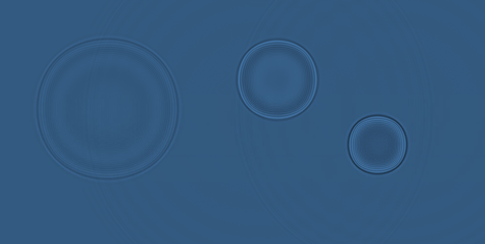
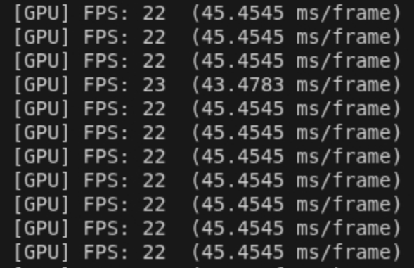

# GPU Wave Simulator



A real-time 2D wave propagation simulator built with modern OpenGL and C++. The project
started as an OpenGL image editor and was extended into a physics-based wave simulation
with GPU-accelerated rendering, a scalar-to-color (colormap) visualization, and an
experimental CPU-vs-GPU rendering comparison.

## Project Overview

The application solves a discrete **wave equation** on a 2D grid. Each cell holds a
height value that evolves over time based on its own motion (inertia) and the influence
of its four neighbors. Clicking on the window injects a disturbance ("drops a stone"),
and the resulting ripples propagate, reflect off the edges, and interfere with each
other — all computed every frame and visualized through a GPU shader.

This project was built by first studying an existing OpenGL image-editor codebase to
understand its rendering pipeline (shaders, textures, vertex buffers), then extending it
with a numerical simulation and visualization layer on top of that pipeline.

### What it demonstrates
- Modern OpenGL rendering (core profile, shaders, VAO/VBO/EBO, textures)
- Streaming CPU-computed data to the GPU every frame as a texture
- A fragment-shader **colormap** that maps scalar height values to colors
- A simple finite-difference wave solver running on the CPU
- An FPS/frame-time instrument and a CPU-vs-GPU rendering toggle

## How It Works

### Rendering pipeline
The whole screen is a single textured rectangle. Every frame:
1. The CPU updates the wave grid (`waveStep`) and writes the result into an image buffer.
2. That buffer is uploaded to a GPU texture (`copyData`).
3. A fragment shader samples the texture and applies the colormap, drawing the rectangle.

Separation of concerns:
- **VAO/VBO/EBO** define *where* to draw (the full-screen rectangle).
- **Texture** supplies *what* data to draw (the per-pixel wave heights).
- **Shader** decides *how* each pixel is colored (dark background → light-blue wave).

### Wave equation (per cell, each frame)
```
next = 2*current - previous                         (inertia: keep moving as before)
     + c * (left + right + up + down - 4*current)   (neighbor coupling: get pulled toward neighbors)
```
Three grids (`previous`, `current`, `next`) are kept and rotated each frame so time can
advance. A small damping factor is applied so ripples fade over time.

## Controls
- **Mouse click / drag**: create a wave at the cursor position
- **G**: GPU rendering mode (shader applies the colormap)
- **C**: CPU rendering mode (CPU computes the per-pixel colors)
- **ESC**: quit

Frame rate and frame time are printed to the terminal each second, labeled `[GPU]` or `[CPU]`.

## CPU vs GPU Comparison — Current State & Limitations

The project includes a toggle to render the colormap either on the GPU (in the fragment
shader) or on the CPU (in a per-pixel loop), with an FPS counter to compare them.



**In its current form the comparison is inconclusive.** Both modes still share the same
heavy per-frame CPU work — the wave solver loop over every pixel and the full-texture
upload each frame — which dominates the frame time. The only part that actually differs
between the two modes (the colormap) is a few multiplications per pixel, far too light to
move the needle. As a result the measured FPS is similar in both modes (and bounded by
the CPU-side work, not the GPU).

In other words, the shared CPU cost is the real bottleneck here, so this setup is not yet
a fair or meaningful GPU-vs-CPU benchmark.

**How the comparison becomes meaningful:** adding a computationally expensive per-pixel
operation — for example a blur (averaging a large neighborhood per pixel), or moving the
wave solve itself onto the GPU (GPGPU with ping-pong textures) — would make the differing
work far outweigh the shared cost. Under that kind of heavy workload the GPU's parallelism
should produce a clear, dramatic FPS gap (e.g. CPU dropping to single digits while the GPU
stays smooth). That is the planned next step.

## Build & Run

This project targets **Linux with an OpenGL-capable GPU**.

### Dependencies
- OpenGL 3.3+ (core profile 4.3 requested)
- GLFW 3.x
- GLAD (included in `lib/`)
- stb_image (included in `lib/`)
- GCC/G++ with C++11

### Build with Make
```bash
make
./build/ImageEditor
```

To disable the driver's VSync cap (needed for performance measurement):
```bash
vblank_mode=0 ./build/ImageEditor      # Mesa drivers (Intel/AMD)
# or
__GL_SYNC_TO_VBLANK=0 ./build/ImageEditor   # NVIDIA drivers
```

### Clean
```bash
make clean
```

> Note: `CMakeLists.txt` is out of date (it only lists `main.cpp` and `glad.c`) — use the
> Makefile, which compiles all sources.

## Project Structure
```
GPU_Image_Editor/
├── src/
│   ├── main.cpp              # Entry point
│   ├── Application.cpp       # Main loop, FPS counter, CPU/GPU toggle
│   ├── Window.cpp            # GLFW window + input callbacks (click → wave)
│   ├── Image.cpp             # Pixel buffer + wave solver (waveInit/waveStep/waveClick)
│   ├── Texture.cpp           # Uploads CPU data to a GPU texture each frame
│   ├── ShaderProgram.cpp     # Vertex/fragment shaders (colormap + CPU/GPU branch)
│   ├── TexturedRectangle.cpp # Full-screen rectangle geometry (VAO/VBO/EBO)
│   ├── Button.cpp / ColorButton.cpp  # Original UI buttons (from the image editor)
├── include/                  # Headers
├── lib/                      # glad, stb_image
├── Makefile
└── CMakeLists.txt
```

## Background: From Image Editor to Wave Simulator

The original codebase was a GPU image editor (load an image, draw on it with the mouse,
switch colors, reset). It was used as a foundation to learn how a modern OpenGL rendering
pipeline is wired together. The editor's "upload a changing pixel buffer every frame"
design turned out to be exactly what a real-time simulation needs, so the pixel buffer was
repurposed to carry a wave field instead of a photo, a colormap was added to the shader,
and a finite-difference wave solver was built on top.

The same rendering structure — upload data, color it in a shader, draw a textured quad —
is how scientific tools visualize simulation results (e.g. mapping stress or displacement
values onto a mesh with a colormap). This project is a small, hands-on version of that idea.
